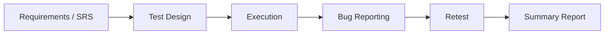

  

  

 

  
  

---

## 👨‍💻 About Me

QA Engineer from **Port Said, Egypt**, graduate of **Information Systems, Suez Canal University**.
I design test cases directly from requirements, report bugs with clear evidence, and track them through retesting.

> Every test case maps back to a requirement. Coverage is traceable, nothing is invented.

---

## 🔍 How I Work

---

## 📘 Projects

| Project | What I Tested | Test Cases | Bugs |
|:--|:--|:--:|:--:|
| [**Guru99 Bank**](https://github.com/Mohab-Elhosseny14/Guru99-Bank-Manual-Testing) | Full cycle: test plan, TCs, bug reports (V1/V2), summary report | 73 | 34 |
| [**Toolshop**](https://github.com/Mohab-Elhosseny14/Toolshop-QA-Testing-Project) | E-commerce checkout flow | 59 | 21 |
| [**Rahal Tour**](https://github.com/Mohab-Elhosseny14/Rahal-Tour-QA-Project) | Travel booking app: Authentication and Home Screen | 100+ | 9–10 |

---

## 🛠️ Toolbox

**Test Management**

**API & Documentation**

**Version Control**

---

  

